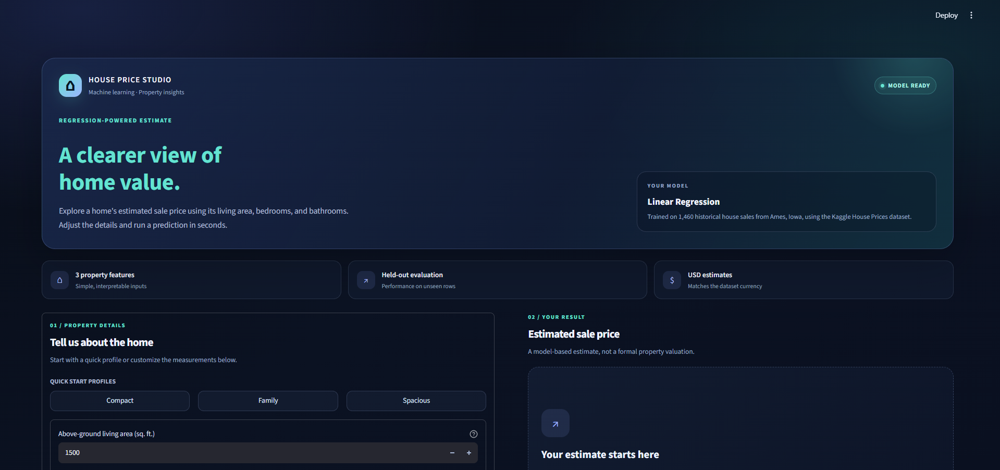
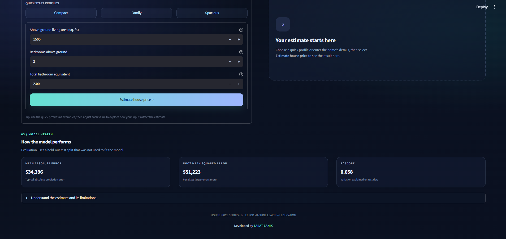
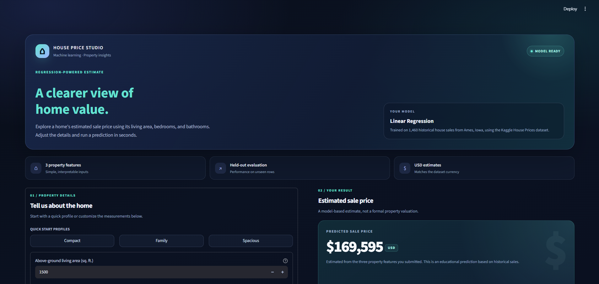
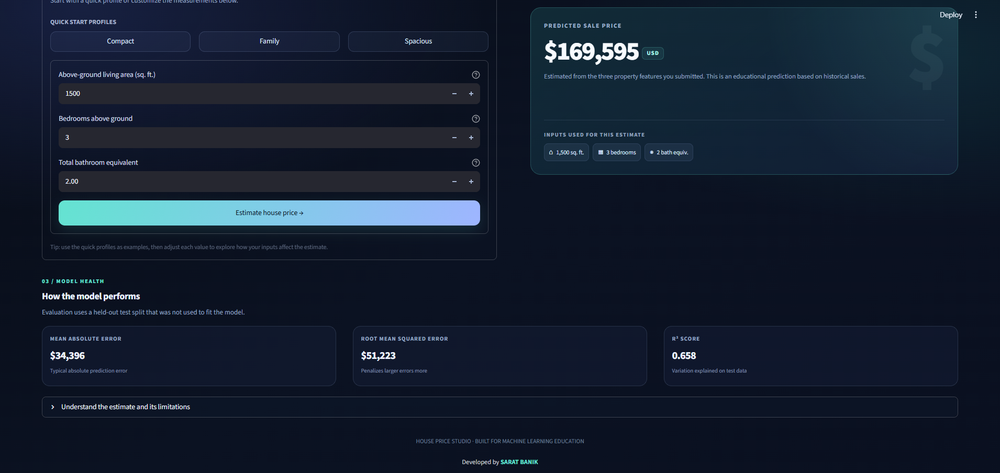

<div align="center">

# House Price Prediction Using Linear Regression

**A simple machine learning project to estimate house sale prices from property features.**

[](https://www.python.org/)
[](https://scikit-learn.org/)
[](https://streamlit.io/)
[](https://www.kaggle.com/c/house-prices-advanced-regression-techniques/data)

</div>

---

## Project overview

This project uses **Linear Regression** to predict a house's sale price from three inputs:

- **Living area (`GrLivArea`)** — above-ground living area in square feet.
- **Bedrooms (`BedroomAbvGr`)** — bedrooms above ground.
- **Total bathrooms (`TotalBaths`)** — full bathrooms count as `1` and half-baths as `0.5`; basement bathrooms are included.

The target is `SalePrice`, recorded in **US dollars (USD)**. The model uses the Kaggle *House Prices — Advanced Regression Techniques* dataset, based on historical house sales in Ames, Iowa. This is an educational baseline, not a formal valuation tool.

## Interface preview

The screenshots below show the interface in order: the dashboard, input controls, a generated prediction, and the full result with model metrics.

### 1. Dashboard overview

<p align="center">
  
</p>

### 2. Property inputs and model health

<p align="center">
  
</p>

### 3. Prediction result

<p align="center">
  
</p>

### 4. Result details and evaluation metrics

<p align="center">
  
</p>

## Key features

- Predicts house prices from living area, bedrooms, and bathroom equivalents.
- Uses a reproducible **80/20 train-test split** (`random_state=42`).
- Handles missing input values with median imputation.
- Reports **MAE**, **RMSE**, and **R²** on held-out data.
- Includes a Streamlit interface and a command-line prediction script.
- Generates actual-versus-predicted and residual diagnostic charts.

## Technology stack

| Tool | Purpose |
|---|---|
| Python | Main programming language |
| pandas and NumPy | Data handling |
| scikit-learn | Preprocessing, linear regression, train/test split, and metrics |
| Matplotlib | Evaluation charts |
| joblib | Saving and loading the trained model |
| Streamlit | Interactive web interface |

## Project structure

```text
Predict-House-Price/
├── app.py                         # Streamlit interface
├── train_model.py                 # Train, evaluate, and save the model
├── predict.py                     # Command-line prediction
├── house_price_prediction.ipynb   # Step-by-step notebook
├── requirements.txt               # Python dependencies
├── README.md
├── PROJECT_REPORT_TEMPLATE.md
├── data/
│   ├── train.csv                  # Labeled training data (download if absent)
│   ├── test.csv                   # Competition test data (no SalePrice labels)
│   └── data_description.txt       # Dataset field descriptions
├── artifacts/
│   ├── house_price_model.joblib   # Saved model (generated by training)
│   ├── metrics.json               # Evaluation metrics
│   ├── model_coefficients.csv     # Model coefficients
│   ├── actual_vs_predicted.png    # Prediction diagnostic plot
│   └── residuals.png              # Residual diagnostic plot
└── assets/
    └── screenshots/               # README interface screenshots
```

Some generated files and CSV datasets are excluded by `.gitignore`. If `data/train.csv` is not present after cloning, download the dataset using the link below and place `train.csv` in the `data/` directory.

**Dataset:** [Kaggle — House Prices: Advanced Regression Techniques](https://www.kaggle.com/c/house-prices-advanced-regression-techniques/data)

> Use `train.csv` for training and evaluation. The competition's `test.csv` has no `SalePrice` column, so it cannot be used to calculate the model's supervised evaluation metrics.

## Getting started

### 1. Clone the repository

```bash
git clone https://github.com/saratbanik/Predict-House-Price.git
cd Predict-House-Price
```

### 2. Create a virtual environment

On Windows using PowerShell:

```powershell
py -m venv .venv
.\.venv\Scripts\Activate.ps1
```

If PowerShell blocks activation, use Command Prompt and run `.venv\Scripts\activate.bat`.

### 3. Install dependencies

```bash
python -m pip install --upgrade pip
pip install -r requirements.txt
```

### 4. Prepare the dataset

Ensure the labeled file exists at `data/train.csv`. If it is missing, download the Kaggle dataset and copy `train.csv` into the `data/` directory.

### 5. Train and evaluate the model

```bash
python train_model.py
```

The script prepares the features, fits the Linear Regression model, evaluates it on a held-out test split, and writes the model, metrics, coefficients, and charts to `artifacts/`.

### 6. Launch the web app

```bash
streamlit run app.py
```

Open the local URL shown in the terminal—usually [http://localhost:8501](http://localhost:8501)—in your browser. Enter the property details or choose a quick-start profile, then select **Estimate house price**.

### Optional: predict from the terminal

After training, run:

```bash
python predict.py --area 1500 --bedrooms 3 --bathrooms 2
```

Bathroom input means full-bath equivalents. For example, one full bathroom and one half-bath can be entered as `1.5`.

## Model evaluation

The included baseline run used 1,460 labeled rows, with 1,168 records for training and 292 for testing.

| Metric | Result | Interpretation |
|---|---:|---|
| **MAE** | **$34,395.80** | Average absolute prediction error |
| **RMSE** | **$51,222.58** | Error metric that penalizes larger misses more heavily |
| **R²** | **0.6579** | Variation explained on the held-out test split |

These results are specific to this train/test split and this three-feature model. Your results may vary if the data, features, or split changes. The values are also written to `artifacts/metrics.json` after training.

## Understanding the metrics

- **MAE (Mean Absolute Error):** average absolute difference between actual and predicted sale prices. Lower is generally better.
- **RMSE (Root Mean Squared Error):** similar to MAE, but larger errors receive more weight. Lower is generally better.
- **R² (coefficient of determination):** indicates how much variation in the target is explained by the model on the held-out data. Values closer to `1` generally indicate a better fit; negative values are possible.

## Limitations

This project is a beginner-friendly baseline, not a production real-estate valuation system. It uses only three predictors and does not account for many price factors, including neighborhood, location, construction quality, condition, age, garage, or lot size. The dataset represents historical sales in Ames, Iowa, so predictions should **not** be interpreted as current property values in India or another market.

## References

- [Kaggle dataset — House Prices: Advanced Regression Techniques](https://www.kaggle.com/c/house-prices-advanced-regression-techniques/data)
- [scikit-learn: `train_test_split`](https://scikit-learn.org/stable/modules/generated/sklearn.model_selection.train_test_split.html)
- [scikit-learn: `LinearRegression`](https://scikit-learn.org/stable/modules/generated/sklearn.linear_model.LinearRegression.html)

---

<div align="center">

**Developed by [SARAT BANIK](https://www.linkedin.com/in/saratbanik)**

</div>
